# 2Dots

Мини-игры для двоих по локальной сети. Каждый играет на своём компьютере за светящуюся точку: розовую или голубую. Подходят ноутбуки и настольные ПК на Windows, а также Mac.

<p align="center">
  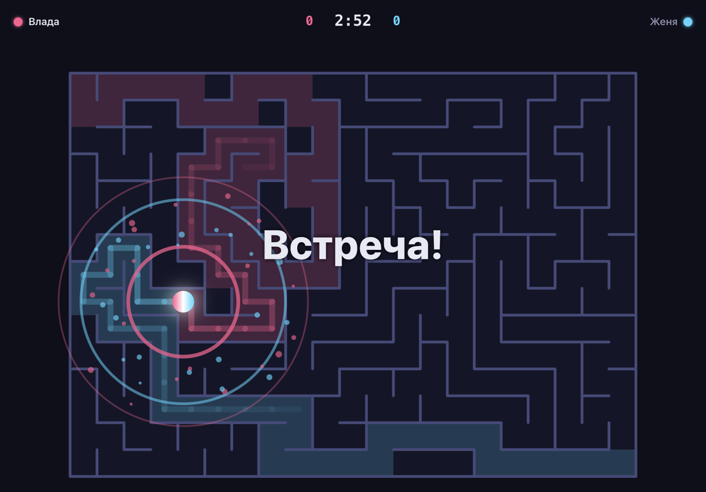
</p>

## Скачать

Последняя версия: **[Releases → latest](https://github.com/Johny314/2Dots/releases/latest)**

| Система               | Файл                                               | Обновления                                          |
| --------------------- | -------------------------------------------------- | --------------------------------------------------- |
| Windows               | `2Dots-X.Y.Z-win-x64-setup.exe` (установщик)       | **сами**: качаются в фоне, ставятся при перезапуске |
| Windows               | `2Dots-X.Y.Z-win-x64-portable.exe` (без установки) | баннер «Вышла версия — Скачать»                     |
| macOS (Apple Silicon) | `2Dots-X.Y.Z-mac-arm64.dmg`                        | баннер «Вышла версия — Скачать»                     |

### Первый запуск

Приложение не подписано, поэтому система спросит разрешение один раз:

- **macOS:** правый клик по 2Dots → «Открыть» → «Открыть». Затем разрешите «Локальная сеть» и входящие подключения.
- **Windows:** SmartScreen → «Подробнее» → «Выполнить в любом случае». В окне файрвола отметьте **частные сети** → «Разрешить».

## Как играть

1. Оба компьютера подключены к одной домашней сети: по Wi‑Fi или кабелем к тому же роутеру, можно вперемешку. На Windows сеть должна быть «Частная», а не «Общественная».
2. Первый игрок нажимает **«Создать игру»**, на экране появляется его адрес.
3. Второй нажимает **«Присоединиться»**: игра находится сама, или нужно ввести адрес с экрана первого.
4. В лобби хост выбирает мини-игру и её настройки, оба нажимают **«Готов»**, начинается отсчёт 3‑2‑1.
5. Управление: стрелки или WASD. Матч идёт до 3 побед.

<p align="center">
  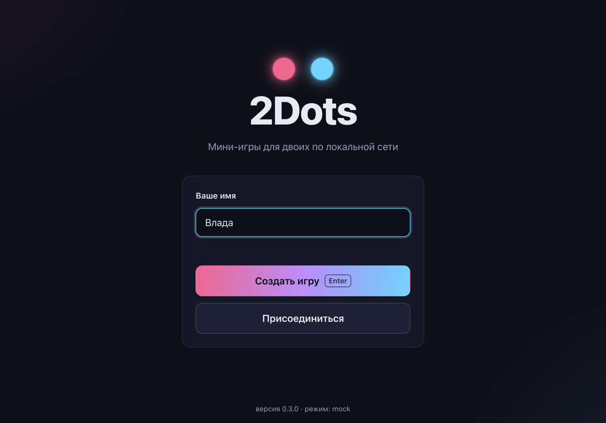
  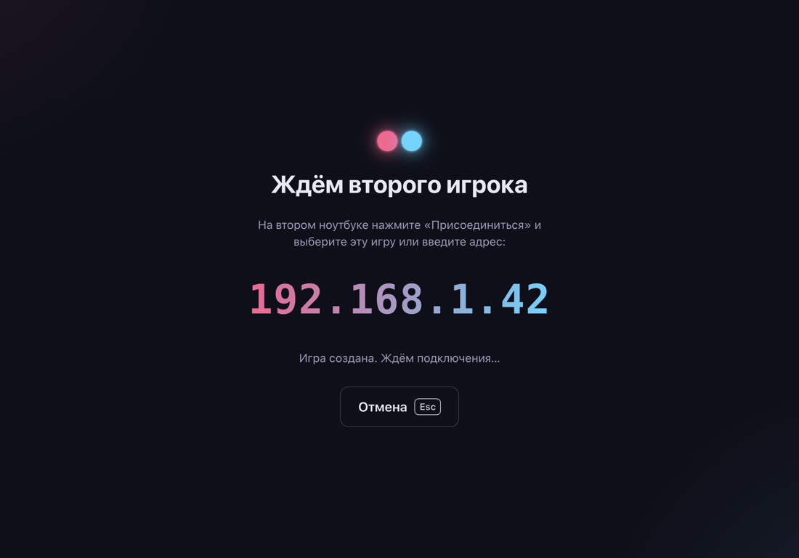
  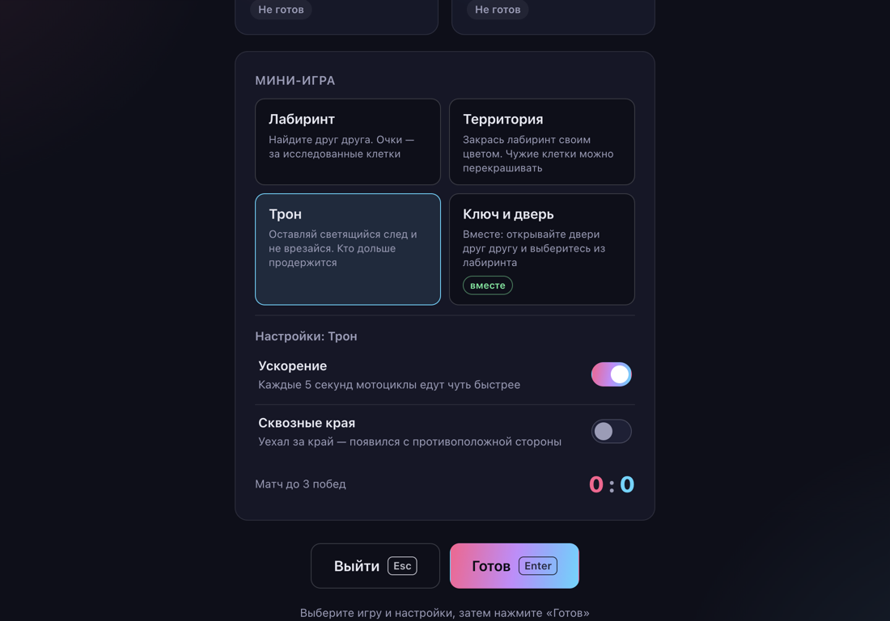
</p>

## Мини-игры

### Лабиринт

Вы стартуете в противоположных углах и должны встретиться. Очки дают исследованные клетки, каждая считается один раз. Если за 3 минуты встречи не было, раунд заканчивается ничьей.

- **Туман войны** (по умолчанию включён): видно 3 клетки вокруг себя и уже пройденный путь.
- **Горячо‑холодно**: шкала и «пинг» вашей точки (волны от синих и редких до красных и частых) подсказывают, насколько близко соперник по ходам в лабиринте.

<p align="center">
  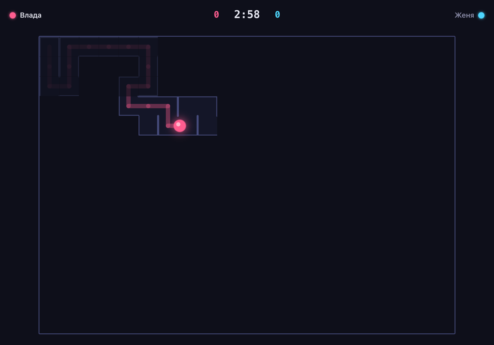
  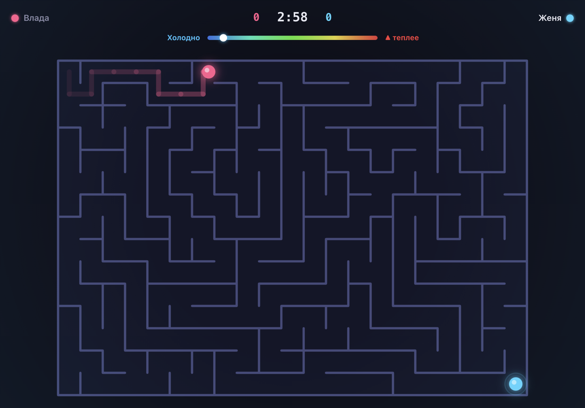
</p>

### Территория

90 секунд нужно красить лабиринт своим цветом, причём чужие клетки можно перекрашивать. Побеждает тот, у кого в конце больше клеток. Настройки: туман войны и длинный раунд (2:30).

<p align="center">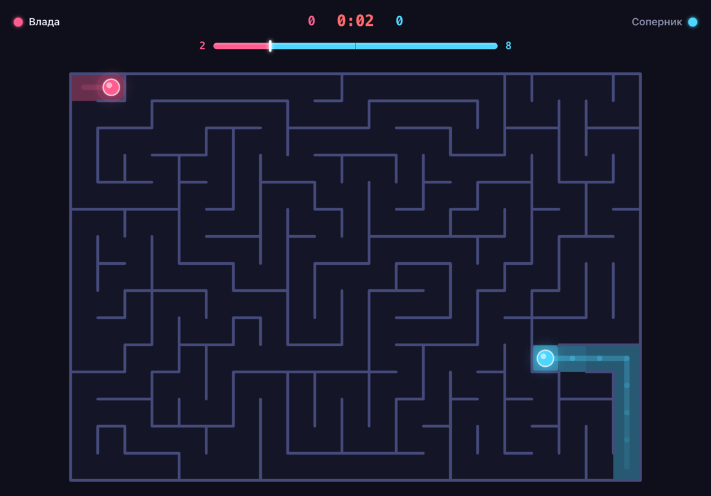</p>

### Трон

Точки едут сами и оставляют за собой неоновый след. Кто врезался в след или стену, тот проиграл. Скорость постепенно растёт. Настройки: ускорение и сквозные края.

<p align="center">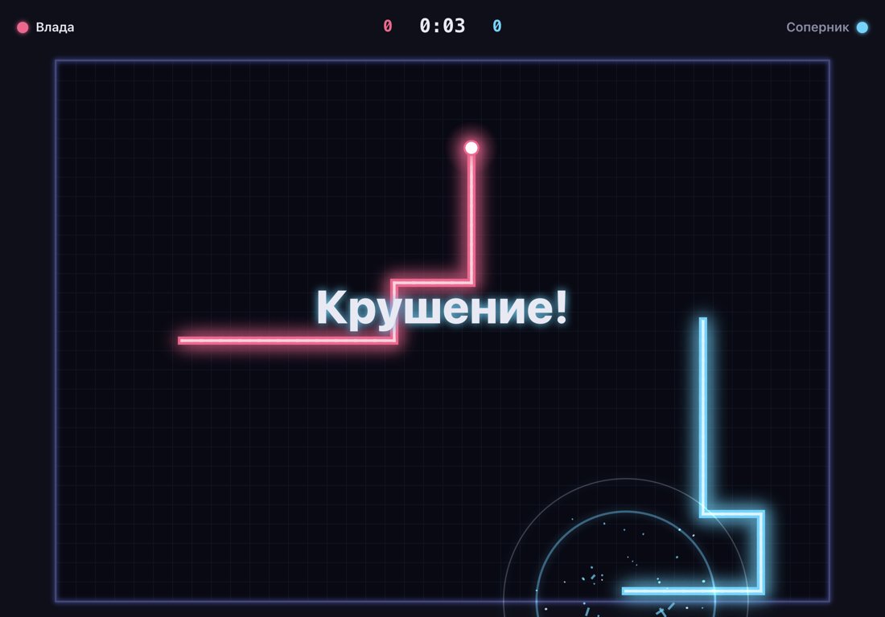</p>

### Ключ и дверь (вместе)

Кооперативная игра: выбраться к порталу в центре нужно вдвоём. На пути каждого стоят двери его цвета, а кнопки от них лежат на стороне напарника, поэтому придётся подсказывать друг другу голосом. Настройки: туман войны (по умолчанию включён) и больше дверей.

<p align="center">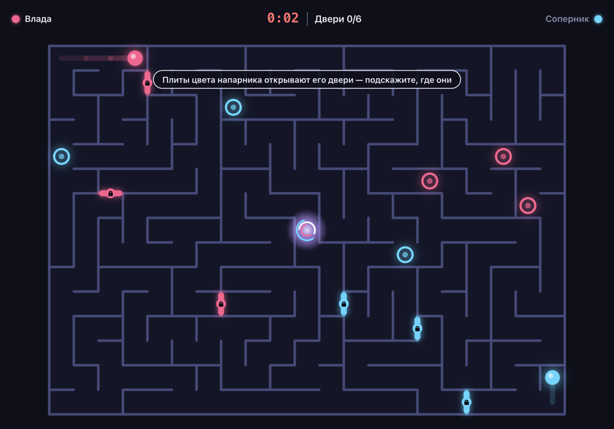</p>

### Прятки

Один прячется, другой ищет. Прячущийся стартует в центре и получает 10 секунд форы, пока искатель «зажмурился». За прячущимся тянется след, который искатель видит сквозь туман, — но если замереть на 3 секунды, след пропадает. У искателя 3 подсказки (H или Пробел): на полторы секунды подсвечивается область, где прячется соперник. Нашёл за 2 минуты — победа искателя, нет — прячущегося. Настройки: роли (случайно или хост выбирает, кто прячется) и «Горячо‑холодно».

### Результат и обновления

После раунда видно, кто уже нажал **«Ещё раз»**, а кого ждут: когда готовы оба, следующий раунд начинается сразу. **«К выбору игры»** возвращает обоих в лобби, не разрывая соединение; Esc во время раунда — тоже в лобби. Закрыть игру для обоих может только хост — кнопкой «В меню» (с подтверждением).

<p align="center">
  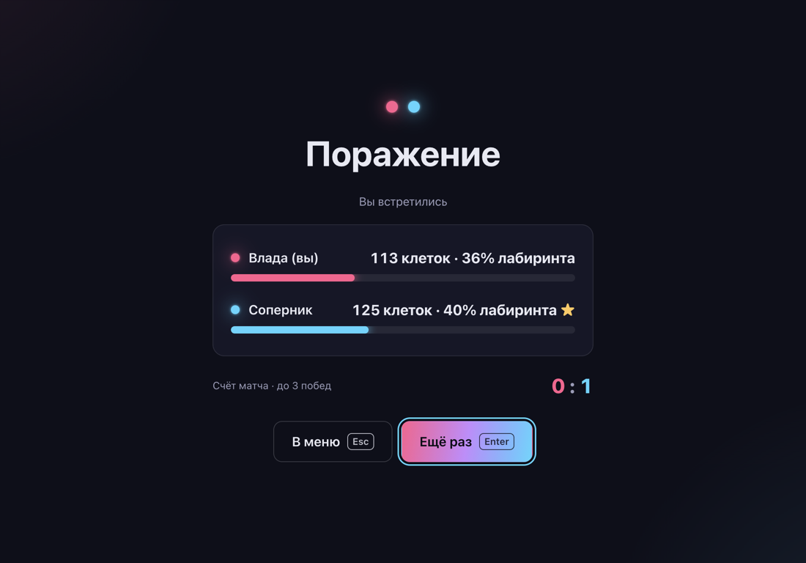
  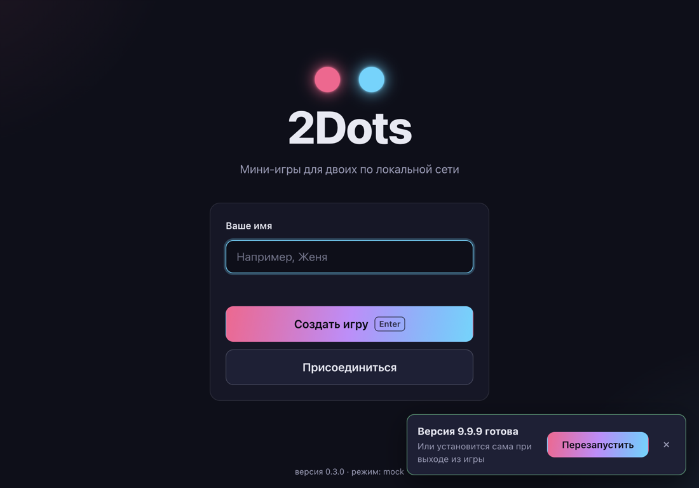
</p>

## Разработка

Нужны Node.js 24+ и pnpm (`npm i -g pnpm`).

```bash
pnpm i
pnpm dev          # приложение
pnpm dev:mock     # интерфейс на моках, без сети
pnpm dev:local    # лабиринт вдвоём на одной клавиатуре
pnpm typecheck && pnpm lint && pnpm test && pnpm test:e2e
pnpm dist:mac     # сборка .dmg (Windows-сборка — в GitHub Actions)
```

Два экземпляра на одном компьютере: `TWODOTS_PORT=47800 pnpm dev`, затем во втором окне «Присоединиться» → `127.0.0.1:47800`. Бот-соперник: `pnpm bot --host 127.0.0.1`. Все команды и правила собраны в [CLAUDE.md](CLAUDE.md).

**Стек:** Electron + TypeScript, Canvas 2D, WebSocket (`ws`) и mDNS (`bonjour-service`), zod, vitest и Playwright, electron-builder, electron-updater.

```
packages/core   чистая детерминированная логика мини-игр и протокол
packages/net    хост-сервер, клиент, поиск в сети
apps/desktop    Electron: окно, экраны, рендереры игр, упаковка
tools/bot.ts    бот для тестов
```

Как устроено и как добавить мини-игру — в [docs/ARCHITECTURE.md](docs/ARCHITECTURE.md), правила игр — в [docs/GAME_DESIGN.md](docs/GAME_DESIGN.md).

### Выпуск версии

1. Поднять `version` в `apps/desktop/package.json` и закоммитить.
2. `git tag vX.Y.Z && git push origin vX.Y.Z`: GitHub Actions соберёт `.dmg` и `.exe` и опубликует релиз.
3. Установленные игры узнают о новой версии сами.
